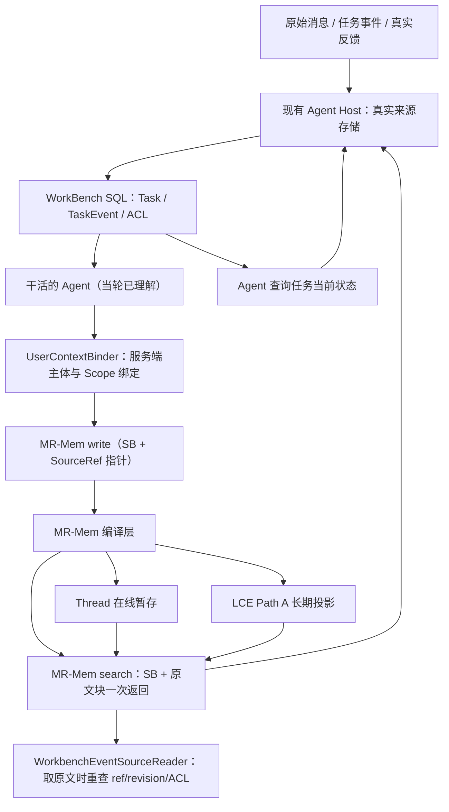

# WorkBench 接入 MR-Mem 的设计推导、整体框架及实施逻辑

> **状态：集成设计草案，非生产已接线。** MR-Mem 的 [ADR-0001](ADR-0001-SIDECAR-MEMORY-BOUNDARY.md) 是已冻结的真实架构权威；本文不得修改其定义。
> 
> 场景：不同 Agent 在 WorkBench 中协作处理同一个用户的项目与任务，同时需要召回过往讨论、决策理由、偏好和长期关系语境。

## 1. 为什么需要接入，又为什么不把任务写进 MemoryCore

**需求事实：** Agent A 可能接收“下周完成报告”，Agent B 过两天接手继续，Agent C 需要了解为什么之前没有采用另一个方案。

这里有两种不同的信息：

1. **可事务化的业务事实**：任务状态、负责人、截止时间、等待回复、审批结果、交付链接。必须由 WorkBench SQL 负责一致性、查询、审计、幂等与授权。
2. **语义和长期认知**：此前的讨论、经验教训、已明确的用户偏好、某个方案为何被放弃、后续信息如何改变早先认识。由 MR-Mem 的 Canonical → Thread/LCE 路径负责。

不将业务事实塞进 MR-Mem 的原因是：语义编译有延迟；检索结果可能召回旧版本；每次人类说话也不必产生永久记忆；对任务的“写入成功”需要真正的 SQL 原子性与可观察 receipt。反过来也不应该将长期语义重建成 WorkBench 的第二个知识库。

因此采用单向路径：**原文留在 Host/WorkBench → 干活的 Agent 当轮调用 MR-Mem `write` → MR-Mem 编译层（指针指回原文）→ Thread/LCE 投影**。Task SQL 不与 MR-Mem 做双向事实同步。

**对 Agent 只有两个工具：`write` 和 `search`（2026-11-09 定）。**
- `write`：正在处理任务的 Agent 已经理解了这一轮，借着已缓存的上下文顺带写下语义（推理过的不再推理），不另设事后的语义筛选或编译服务；
- `search`：SB 和对应原文块一次返回，没有单独的 `read`；
- 编译层只存指向原文的指针（SourceRef），原文不重复录入 MR-Mem。

## 2. 整体架构与模块接口



拥有者和模块边界：

| 关心点 | 归属 | 在本分支中的代码/契约 |
|---|---|---|
| 账号映射、Workspace/Task ACL、记忆授权 grant | WorkBench Host | WorkBench `user_context.py` + SQL `memory_context_grants` |
| scope 绑定与来源一致性核验 | MR-Mem 可选接入适配 | `src/mr_mem/integrations/workbench_host.py` |
| Raw Event 解析、是否能查看当前行 | Host-owned WorkBench resolver | `WorkbenchEventResolver` Protocol（实现未接入） |
| 语义的理解 | 干活的 Agent（当轮） | 随 `write` 一并给出；**不另设事后的语义筛选或二次编译** |
| 语义存储、检索、Thread/LCE | MR-Mem | 对 Agent 只有 `write` / `search`；内部落到既有编译层与投影 |
| 当前业务任务、Run、工具完成、到期提醒 | WorkBench / Agent Host | **禁止**交给 MR-Mem 存储和执行 |

## 3. SourceRef 为什么比复制全文更重要

`SourceRef` 至少需要回答：**哪一个来源、哪一个工作空间、哪一条事实、什么事件时间、当前哪个版本？**

本分支约定工作台任务事件的来源定位：

```text
source_namespace = "agent-workbench.task-event"
session_id       = <受信工作空间 ID>
record_id        = <task_event.id>
occurred_at      = <原事件发生时间（UTC）>
revision         = <事件来源的稳定版本/指纹>
```

这是 MR-Mem 的内部来源标识约定；**不是可由不可信用户提交的访问权限 Token**。实际数据仍由 WorkBench SQL 与 Host 自有来源查询返回。即使用户知道 record_id，也不能绕过任务/证据行级权限。

设计约束：

- WorkBench event ledger 为不可变追加记录，不允许复写同一个 ID 的原始事实；
- 事件后续更正、撤回或失效，Host 提供当前 version/deleted 状态，并按已有 `canonical.invalidate_source` 机制处理受影响记忆；
- 同一事件在不同时间的编译版本不应制造重复的“独立证据”，Thread 成熟度仍以独立来源事件而非碎片数量计；
- `occurred_at`、Workbench `recorded_at`、MR-Mem `known_at` 不得混淆；用户今天谈起过去发生的事，不等于把该事发生时间重写成今天；
- MR-Mem 可以缓存索引、摘要和指针，但不得拥有第二份原始会话数据库。

## 4. 权限设计：多 Agent 共享不等于多用户共享

用户在 Telegram 或其它 Agent 中给出任务要求，Host 先从已验证的连接身份解析出 principal / workspace / user。模型不得直接选择这些字段。

```text
verified transport actor
  → WorkBench principal + membership / task ACL
  → explicit memory_context_grants (read or write)
  → UserContextBinder.bind(...)
  → BoundUserContext (one USER scope, one capability)
  → WorkbenchEventSourceReader.current_ref/render_source
       → EVERY ACCESS reauthorize current grant
       → Host WorkbenchEventResolver checks object-level visibility
       → return only current, authorized event revision/text
```

为什么在 bind **之后还要重新检查授权**：长期运行的 Host 可能缓存上下文；之前有权的人可能已经被撤销。一次性的身份确认不能变成永久的记忆读许可。现有 adapter 在 `current_ref` 和 `render_source` 重查当前 grant，且读、写是不同 capability。**但真实的 WorkBenchEventResolver 还没接线，事件级授权和竞态防护仍需系统级验证。**

### 不能凭操作回执制造语义权威

以下事件应当保留在业务系统，不应自动被当作人的永久认知变化：

- Host Run 完成、工具返回 200、Telegram 发送成功；
- 模型总结“用户应该高兴了”；
- 内部 Timer 到期、任务优先级自动重排；
- Agent 自己说“我记住了用户承诺”，但没有权威来源。

只有来源合法、语义经过 Host 审核的提案，才能作为候选进入 MR-Mem。一个真实用户对交付的反馈可以提供新证据；消息送达本身不能证明用户满意或关系改善。

## 5. 读链、写链与故障场景

**读链：** Host 身份认证 → WorkBench SQL 查任务当前态/version → 如确实需要历史背景，按精确 USER scope 调 `search` → MR-Mem 一次返回 SB 和对应原文块（取原文时 adapter 重查授权，无权的原文不返回）→ 合成答案时区分当前状态、历史解释与推断。若 MR-Mem 落后，不能据此撤回 SQL 中已经完成的事实。

**写链：** WorkBench 单事务写任务快照+TaskEvent → 正在处理这件事的 Agent 在同一轮里调用 `write`，带上它对这一轮的理解和指向 TaskEvent/原消息的 SourceRef → MR-Mem 校验 SourceRef 当前版本和 scope 后写入编译层 → Thread/LCE 按既有机制投影。不经 Outbox 再交给另一个模型重判一遍。

| 故障 / 反例 | 预期处理 |
|---|---|
| MR-Mem 不可用 | WorkBench 业务照常提交；`write` 进 Host 本地重试队列（WorkBench 工作 bot 已有 `memory-retry.jsonl`，重放前重查授权，被撤权的直接丢弃） |
| 同一轮被 `write` 多次（重试） | 按 SourceRef 身份、当前来源版本与语义 ID 幂等 |
| 用户撤权但已有 BoundUserContext | 再次 read/hydrate 时拒绝 |
| Task 的当前状态变了，MR-Mem 仍召回旧状态 | SQL 当前态优先；旧语义是历史而非现在 |
| 原文已删除 / 来源 revision 变化 | 校验失败，走 source invalidation/rebuild，不继续提供失效原文 |
| Agent C 有 shared workspace 但无 owner's user-memory grant | 不授权；不能从向量候选绕过 ACL |
| Host Run 返回 completed | 这只是操作回执，不直接形成新长期记忆或 Task DONE |

## 6. 为什么不做的替代方案

| 方案 | 不采用的理由 |
|---|---|
| WorkBench 任务直接写入 MR-Mem Canonical 作为“当前事实” | 语义写入延迟且缺业务事务；会生成并行权威 |
| 在 MR-Mem 内运行 Telegram Bot、Schedule 或 Agent Loop | 破坏 Sidecar 边界，重复 Host/Workbench |
| 把用户 profiles、私人任务放进每个 Agent 自身长期系统提示 | 无统一权限、易过期、无法审计版本 |
| 扫描整个原始聊天并定时全量重建 | 浪费资源且可能制造过时结论；应使用增量 SourceRef + eligibility |
| 外部用户共享同一个 USER Scope | 易出现私人信息泄漏；需要显式 grant 和受信映射 |
| 另设 memory_outbox + 事后语义筛选/编译器 | 干活的 Agent 当轮已理解过；再交给另一个模型判一遍是第二次推理，费用翻倍，且会和当轮理解不一致 |
| 单独的 `read` 工具 | 要调两次工具；`search` 已经把 SB 和原文块一起返回 |
| 直接把 AML 评测服务的 `/add`/`/search` 暴露给生产 Agent | 形状与 `write`/`search` 相同，但评测服务没有 Host 鉴权；生产须经 `UserContextBinder` 和按次重查授权 |

## 7. 当前代码状态与后续验收

本分支**已经有**：可选 `UserContextBinder`、`BoundUserContext`、`WorkbenchEventSourceReader`、`UserContextAuthorizer` 和 `WorkbenchEventResolver` 协议；权限撤销后重新验证的单元测试。没有改动 MemoryCore、Thread、LCE 路径。

本分支**没有**：真实可用的 SQL Resolver、Host 原文存储对接、生产 `write`/`search` 接线（含 Agent 侧工具定义）或跨 Agent 回查的端到端测试。

验收次序：

1. 接真实 Host SQL resolver，完成 task/event 级 ACL 与删除/修订测试；
2. 用两个 Agent 读取同一任务 current SQL vN，但不同用户 scope 只可见合法 MR 记忆；
3. 模拟 SQL 更新成功、MR-Mem 停止/恢复，验证 projection 追赶和不重复；
4. 模拟授权被撤销、来源变更、删除，确保旧引用与缓存均不能继续泄漏；
5. 验证 Thread/LCE 不因同一业务事件重复编译而制造虚假支持；
6. 单独修复本仓早已有的 AML smoke 旧参数兼容问题；未通过前不将整个 PR 认定为绿色。

关联：
- [Host 集成契约](WORKBENCH_HOST_CONTRACT.md)
- [Workbench 项目蓝图](https://github.com/Jasonatafricanow/Agent-WorkBench/blob/main/docs/PROJECT_BLUEPRINT.md)
- [Mind Runtime 设计推导](https://github.com/Jasonatafricanow/Mind-Runtime/blob/docs/always-on-workbench-boundary-20261116/docs/integrations/WORKBENCH_DESIGN_RATIONALE.md)

**结论：** MR-Mem 在这三个项目中持续承担“经历和理解如何持久”的责任；不承担“任务是否完成”或“工具何时续跑”的权威。前者已经是成熟记忆内核能力，后两者属于其它系统，不能因 Always-on 话题而回流到 MemoryCore。
